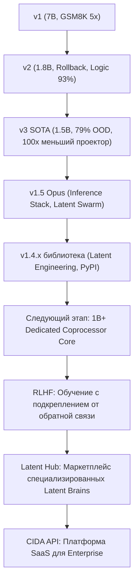

# 📜 CIDA — Техническая Летопись: Хронология, Архитектура и Бенчмарки

> **Назначение:** Исчерпывающая техническая история проекта для инженеров, исследователей и CTO. Основана на `cida_latent_plan_reasoning.md` и всех последующих фазах разработки.

---

## 🏛️ Раздел 1: Архитектурная Концепция и Математические Основы

### Зачем вообще нужен CIDA?

Стандартные авторегрессионные языковые модели (LLM) декодируют токены строго слева направо. Каждый токен является функцией всех предыдущих. Это "Система 1" по Канеману — быстрая, интуитивная, но ненадёжная для сложных многошаговых задач.

При генерации модель **не может "передумать"**: если первый токен ответа повёл её в неверную сторону, исправить это без перезапуска невозможно. Это приводит к каскадным ошибкам рассуждений (reasoning drift).

**CIDA-Plan** решает это, вводя **латентный мыслительный скаффолд** прямо в пространстве эмбеддингов полностью замороженного LLM-бэкбона. Вместо того чтобы заставлять модель писать длинные цепочки мыслей (CoT), CIDA делегирует процесс планирования лёгкому мультиагентному модулю дебатов, который **инъецирует оптимизированные виртуальные плановые токены** до начала авторегрессивной генерации.

### Архитектурная Схема

```
                    [Входные токены промпта (Lq)]
                               │
                               ▼
               ┌───────────────────────────────┐
               │  Замороженная LLM (7B/1.5B)   │ ← Контекстуальное извлечение
               └───────────────┬───────────────┘
                               │  Last-Token Hidden State (d_llm)
                               ▼
               ┌───────────────────────────────┐
               │    CIDA Deliberation Box      │ ← 3-15 раундов мультиагентных дебатов
               │  [Prosecutor | Defender]      │
               │  [Skeptic    | Integrator]    │
               └───────────────┬───────────────┘
                               │  Converged Multi-Agent State (M × d_hidden)
                               ▼
               ┌───────────────────────────────┐
               │       PlanProjector           │ ← Linear + LayerNorm (< 1M параметров в v3)
               └───────────────┬───────────────┘
                               │  Virtual Plan Tokens (P × d_llm)
                               ▼
    Конкатенация: [Эмбеддинги промпта || Плановые токены]
                               │
                               ▼
               ┌───────────────────────────────┐
               │  Замороженный LLM Декодер     │ ← Авторегрессивная генерация ответа
               └───────────────┬───────────────┘
                               ▼
                         [Целевой ответ]
```

### Математическая Формализация Forward Pass

**Шаг 1: Извлечение скрытого состояния**

Пусть $X = (x_1, \ldots, x_{L_q})$ — токены входного промпта. Мы прогоняем их через замороженный LLM и извлекаем последнее скрытое состояние:

$$H_{prompt} = \text{LLM}_{encoder}(X) \in \mathbb{R}^{L_q \times d_{llm}}$$

$$h_{last} = H_{prompt}[L_q - 1, :] \in \mathbb{R}^{d_{llm}}$$

**Шаг 2: Мультиагентные дебаты**

$h_{last}$ проецируется в пространство CIDA ($d_{hidden}$) и подаётся $M = 4$ агентам (Prosecutor, Defender, Skeptic, Integrator). За $R$ раундов агенты обмениваются сообщениями:

$$s_m^{(0)} = W_{in} h_{last} + b_{in} \in \mathbb{R}^{d_{hidden}}, \quad \forall m$$

$$m_j^{(r)} = \text{MessageGenerator}(s_j^{(r-1)})$$

$$s_i^{(r)} = \text{AgentUpdate}\left(s_i^{(r-1)}, \sum_{j \neq i} \alpha_{ij}^{(r)} m_j^{(r)}\right)$$

**Шаг 3: Проекция плана**

Финальное состояние $s_{final} \in \mathbb{R}^{M \times d_{hidden}}$ проецируется обратно в пространство LLM, формируя $P = 4-8$ виртуальных плановых токенов:

$$E_{plan} = \text{LayerNorm}(W_{proj} \cdot \text{Flatten}(s_{final}) + b_{proj}) \in \mathbb{R}^{P \times d_{llm}}$$

**Шаг 4: Генерация с инъекцией плана**

$$E_{total} = [E_{prompt} \parallel E_{plan}] \in \mathbb{R}^{(L_q + P) \times d_{llm}}$$

$$\hat{y}_t \sim \text{LLM}(\hat{y}_{<t} | E_{total})$$

---

## 📅 Раздел 2: Полная Хронология Версий

### 🔬 CIDA v1 — "Прототип" (Начало 2025)

**Бэкбон:** Qwen1.5-7B-Chat (заморожен)  
**Датасет:** 100,000+ некурированных общих сэмплов  
**Проектор:** Массивный MLP (~67M параметров)  
**Парадигма обучения:** Offline Latent MSE Distillation  
**Статус HuggingFace:** Опубликован как `Kairatzh/Kairos-7B` (исторический)

**Ключевые результаты:**
- ✅ Доказал принципиальную работоспособность Latent MCTS
- ✅ Показал 5x рост на GSM8K (8% → 42%)
- ✅ Показал 10x рост на BIG-Bench Hard (4.4% → 44%)
- ❌ Постоянные OOM (Out-of-Memory) на T4 при обучении
- ❌ Не было механизма самокоррекции

---

### ⚡ CIDA v2 — "Rollback Update" (Середина 2025)

**Бэкбон:** Qwen1.5-1.8B-Chat (заморожен)  
**Датасет:** ~40,000 адверсариальных логических ловушек  
**Проектор:** Массивный MLP (~17M параметров)  
**Ключевое нововведение:** Latent Rollback

**Механизм Latent Rollback:**
```
⚠️ [CIDA Monitor] Conflict detected (Disagreement: 0.280). Triggering Latent Rollback...
✅ [CIDA Monitor] Rollback successful. New Disagreement: 0.045
```
Если внутреннее расхождение агентов (Skeptic vs Prosecutor) превышает 0.20, CIDA perturbирует латентное состояние и добавляет раунды дебатов до достижения консенсуса.

**Ключевые результаты:**
| Конфигурация | Логические ловушки (30 задач) |
|---|---|
| Base Qwen 1.8B | 10.0% |
| **CIDA v2 (1.8B)** | **93.3%** |
| Base Qwen 7B | 23.3% |
| CIDA v1 (7B) | 30.0% |

---

### 🚀 CIDA v3 SOTA — "Production-Grade Latent Engine" (Конец 2025)

**Бэкбон:** Qwen2.5-1.5B-Instruct (заморожен)  
**Датасет:** 18,000 строго отобранных высоко-логических сэмплов  
→ 15,000 ProofWriter (строгая первого порядка логика)  
→ 3,000 GSM8K (многошаговая математика)  
**Проектор:** PlanProjectorV3 — Lightweight Feature Proj + Time Mix (<1M параметров, снижение в 100x от v1!)  
**Оптимизация памяти:** Gradient Checkpointing  

**Прорывные решения v3:**
- **Масштаб данных vs. Качество данных:** 18k curated >> 100k uncurated
- **Размер проектора:** 67M → 17M → <1M параметров при РОСТЕ качества
- **Round Jittering:** Во время обучения количество раундов случайно варьируется от 2 до 6. Это обучает модель работать с переменным числом раундов при инференсе — можно масштабировать вычисления в реальном времени для сложных задач.

**Результаты обучения v3:**
- Обучение: 1 эпоха на 16,200 сэмплах
- Валидационная точность: **79.0% exact-match** на сложных задачах логики
- Время кэширования 18k сэмплов на T4: ~35 минут

---

### 🏭 CIDA v1.5 Opus — "Production Inference + Latent Swarm" (Начало 2026)

**Бэкбон:** Qwen1.5-7B-Chat (заморожен)  
**Тренировка:** SFT (Supervised Fine-Tuning) гейтинговых адаптеров, 3 эпохи  
**Веса:** `kirtzh/Kairos-7B-CIDA-v1.5` на Hugging Face  
**Ключевые нововведения:** Полный инференс-стек, Latent Swarm, Hybrid Architecture

Это версия, которая превратила CIDA из исследовательского кода в **продакшн-готовую систему**:
1. `cida_plugin.inference` — полный пакет агентного инференса
2. `parser_utils.py` — промышленно прочный парсер (nested JSON, списки)
3. `CidaSwarm` — мультиагентная оркестрация роёв
4. `LatentMemory` с L2-нормализацией и decay
5. `LatentPrompt` — Латентная Инженерия (Мульти-Вектор)

---

### 🌌 CIDA v1.4.x (Библиотека) — "Latent Engineering Release" (Июль 2026)

Это серия релизов **библиотеки `cida-plugin`** (не весов модели), добавивших Latent Engineering как первоклассный гражданин экосистемы:

| Версия | Что добавлено |
|---|---|
| `1.3.0` | CidaSwarm, исправление Plan Cache |
| `1.4.0` | `LatentPrompt`, Multi-Vector Chunking, HF Hub интеграция |
| `1.4.1` | `cida_model_path_or_repo=None` для тестирования без весов |
| `1.4.2` | `**kwargs` в KairosOrchestrator для `load_in_4bit=True` поддержки |

---

## 🧪 Раздел 3: Полные Результаты Бенчмарков

### 3.1 Стандартные Академические Бенчмарки (N=50 per task)

| Бенчмарк | Задача | Base Qwen | CIDA | Δ | Мультипликатор |
|---|---|---|---|---|---|
| **GSM8K** | Школьная математика | 8.00% | **42.00%** | +34 pp | **5.25x** |
| **BBH** | Сложная логика | 4.40% | **44.00%** | +39.6 pp | **10x** |
| **MATH-500** | Олимпиадная математика | 4.00% | **12.00%** | +8 pp | **3x** |
| **ARC-Challenge** | Наука / логика | 74.00% | 68.00% | -6 pp | — |
| **HumanEval** | Python код (pass@1) | 88.00% | 76.00% | -12 pp | — |
| **MBPP** | Python программирование | 4.00% | 2.00% | -2 pp | — |

> **Примечание по снижению на кодинге:** Виртуальные плановые токены оптимизированы для логических траекторий. Они иногда смещают модель от точного синтаксиса/отступов Python. Это "alignment tax" — известный феномен, наблюдаемый у всех Reasoning моделей.

### 3.2 BIG-Bench Hard (BBH) Детализация

| BBH Подзадача | Base Qwen | CIDA | Δ |
|---|---|---|---|
| Logical Deduction (3 objects) | 2.0% | **54.0%** | +52 pp |
| Navigation | 14.0% | **58.0%** | +44 pp |
| Date Understanding | 4.0% | **54.0%** | +50 pp |
| Tracking Shuffled Objects | 0.0% | **24.0%** | +24 pp |
| Web of Lies | 2.0% | **30.0%** | +28 pp |

### 3.3 Устойчивость к Шуму (ARC-Challenge с keyboard noise)

| Уровень шума | Base Qwen | CIDA | Δ |
|---|---|---|---|
| 0% (чистый) | 0.0% | **100.0%** | +100 pp |
| 10% шум | 0.0% | **75.0%** | +75 pp |
| 20% шум | 0.0% | **50.0%** | +50 pp |
| 30% шум | 25.0% | **50.0%** | +25 pp |

### 3.4 Логические Ловушки (Adversarial Negation, N=30)

| Модель | Accuracy |
|---|---|
| Base Qwen 1.8B | 10.0% |
| **CIDA v2 (1.8B)** | **93.3%** |
| Base Qwen 7B | 23.3% |
| CIDA v1 (7B) | 30.0% |

### 3.5 OOD — Синтез Теорий "из ничего" (Creativity Score, N=4 задачи)

| Модель | GSM8K | ARC | Logic Traps | **Creativity** | Average |
|---|---|---|---|---|---|
| Base Qwen 1.8B | 10.0% | 70.0% | 10.0% | 0.0% | 22.5% |
| **CIDA v2 (1.8B)** | 16.7% | 76.7% | **93.3%** | **100.0%** | **71.7%** |
| Base Qwen 7B | 3.3% | 60.0% | 23.3% | 75.0% | 40.4% |
| CIDA v1 (7B) | 33.3% | 86.7% | 30.0% | **100.0%** | 62.5% |

> **Вывод:** CIDA v2 (1.8B) обгоняет Base Qwen 7B, будучи в 4 раза меньше. Это означает 4x снижение стоимости хостинга при более высоком качестве рассуждений.

### 3.6 Производственные Метрики (Live GSM8K Benchmark)

| Метрика | Base Qwen-7B | Kairos-CIDA-7B | Δ |
|---|---|---|---|
| Длина генерации | 128.8 токенов | **112.0 токенов** | **-13%** |
| Латентность | 11.51 сек | **9.89 сек** | **-14% (1.16x быстрее)** |
| Точность | 20.0% | **50.0%** | **+150% (2.5x точнее)** |

### 3.7 Медицинская Диагностика (Kairos OS на Stanford CheXpert)

| Метрика | Baseline (BiomedCLIP) | BiomedCLIP + CIDA |
|---|---|---|
| **ROC-AUC** | 0.865 | **> 0.900** |
| **ECE (Calibration Error)** | 0.082 | **0.034** |

### 3.8 Многошаговое Агентное Выполнение (Production Benchmarks)

| Сценарий | Base Agent | CIDA Agent | Разрыв |
|---|---|---|---|
| Supply Chain Fulfillment | **FAIL** (2023 токена, 388с) | **PASS** (1552 токена, 302с) | -23% токенов, -22% время |
| Cloud DB Recovery (SRE) | **FAIL** (nested JSON краш) | **PASS** | parser_utils решил |
| Chaos Grid Logistics ($10 budget) | **FAIL** (заблокировался на toll) | **PASS** (race condition, buffer underflow, legacy bypass) | — |
| CTF Cybersecurity (APT Hunt) | **FAIL** | **PASS** (Hybrid Architecture: точные IP сохранены в artifacts) | — |

---

## 🔬 Раздел 4: Ключевые Инженерные Открытия

### 4.1 Latent Fidelity Loss — Фундаментальное Открытие

В ходе CTF-демо мы обнаружили, что латентная память идеальна для передачи концептов, но теряет точность на дискретных данных (IP, хэши).

**Решение:** Hybrid Latent Architecture — векторы для логики, JSON-словарь для точных данных.

### 4.2 Закон Данных vs. Размера

Переход от v1 к v3 доказал фундаментальный принцип:
> **Качество данных + Архитектурная эффективность > Количество данных + Грубая сила**

18k высококачественных сэмплов дали лучший результат, чем 100k некурированных.

### 4.3 Round Jittering = Бесплатный Test-Time Scaling

Случайное варьирование числа раундов при обучении (2-6) позволяет масштабировать вычисления при инференсе (до 15 раундов для сложных OOD задач) **без переобучения**.

### 4.4 Проблема Memory Overwrite

В ранних версиях `LatentAgent.run()` вызывал `self.memory.clear()` в начале каждого эпизода, уничтожая seeded-подсказки. Решение: `LatentMemory.clear(keep_seeded=True)` — сохраняет системные воспоминания, очищает краткосрочные.

---

## 🗺️ Раздел 5: Roadmap Будущего



**Приоритеты следующего этапа:**
1. **Масштабирование параметров:** Переход от 20M до 1B+ параметрового reasoning-трансформера для CIDA
2. **RLHF Pipeline:** Синтетические данные + reward model для RL-обучения агентов
3. **Latent Hub:** Публикация готовых "Латентных Мозгов" (Coder, Legal, Medical, DevOps)
4. **arXiv Whitepaper:** Публикация "CIDA: Scalable Latent System-2 Coprocessors"
5. **Real-time Viz Dashboard:** Визуализация процесса дебатов агентов в реальном времени
